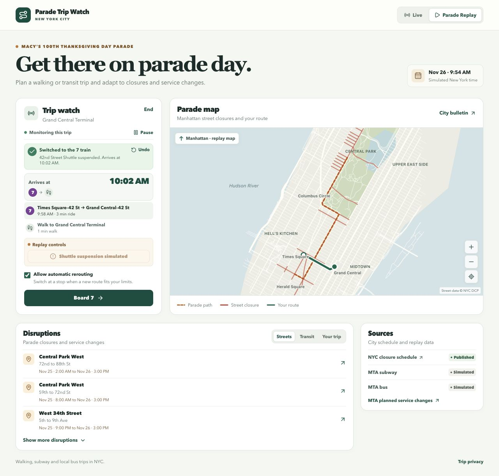

# NYC Parade Trip Watch

A product management project for Macy’s 100th Thanksgiving Day Parade.

## the problem

NYC gets busy on parade day. People still need to get to work, appointments, or family plans. A street closure or subway change can make a good route fall apart while they’re already on the way. I wanted the app to watch the trip and help people adjust without having to keep checking for updates.

**Scope is walking and public transportation only.** This version covers walking, MTA subway, and local bus trips in NYC.

## the product decisions

- I started with trips that have an arrival goal. While the app is open, it checks for disruptions on the parts of the trip the rider still has to take, then compares options using their walking and transfer preferences.
- Riders choose whether to allow automatic rerouting. The app can switch at a stop when the data is fresh and the new route fits. It explains the change and gives them an undo button.
- A calendar or event assistant can surface alerts or fill in a draft trip. The rider reviews it and starts monitoring in the app. That could reach people earlier in their journey. I’d test whether it improves trip completion and whether event organizers or employers would pay for that coverage.

The first thing I’d measure is how long it takes to get a usable route after a disruption. I’d also check whether riders keep their arrival goal, how many choices they have to make, and how often the app suggests an unnecessary switch.

## try the replay

Find routes, turn on automatic rerouting, and start watching the trip. Mark that you’ve reached Times Square, then simulate a shuttle suspension. The app switches to the 7 train, shows the new arrival time, and lets you undo the change.

## the tech stack

I built the app with React, TypeScript, and CSS. It uses Vinext and Vite, with API routes on Cloudflare Workers. Node.js runs the local development tools and tests.

In Live mode, the Maps JavaScript API draws the map, Places Autocomplete helps riders find stops and addresses, and the Routes API calculates walking and transit options. The app checks those options against MTA alerts and city street closures before suggesting a change.

## run it

Use Node.js 22.13 or newer.

    npm run install:ci
    npm run dev

Open [the local app](http://127.0.0.1:5173/). Parade Replay runs without API keys. For Live mode, copy `.dev.vars.example` to `.dev.vars` and set `GOOGLE_MAPS_DEMO_KEY` with your own key for Maps JavaScript, Places, and Routes.

Live mode uses [Google Maps](https://developers.google.com/maps/demo-key), the [MTA alerts feeds](https://api.mta.info/), and the [city’s parade closure schedule](https://www.nyc.gov/assets/cecm/downloads/pdf/thanksgiving-standard-street-closures-2026.pdf). The replay map uses [NYC DCP street data](https://data.cityofnewyork.us/City-Government/LION/2v4z-66xt). Stop matching uses [MTA station data](https://data.ny.gov/Transportation/MTA-Subway-Stations/39hk-dx4f).

Run `npm test` for the rerouting checks.
